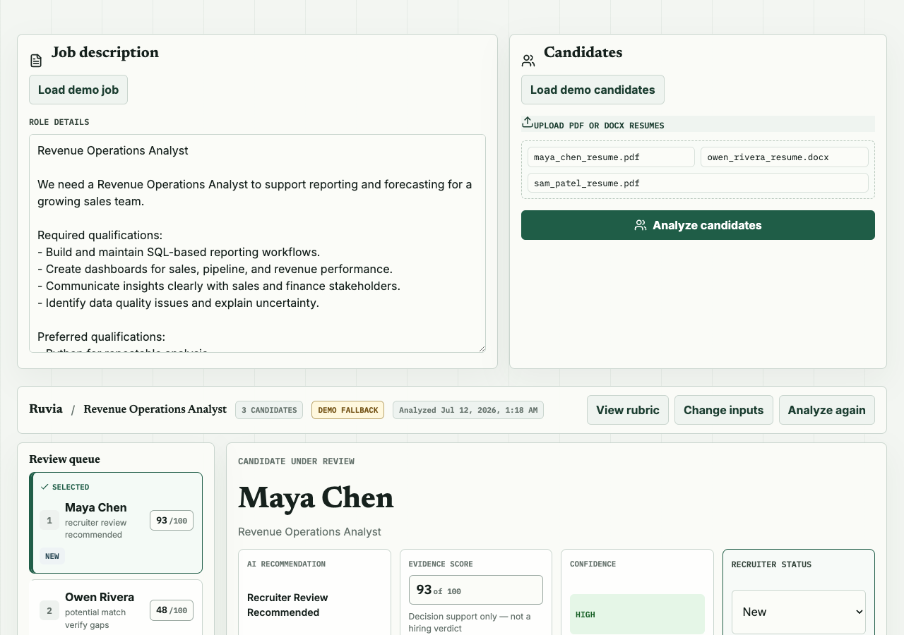
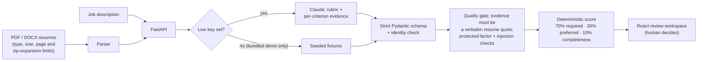

# Ruvia

**Evidence-first recruiting decision support.** Ruvia turns a job description and up to three resumes into a candidate-review workspace. Every claim it shows quotes the resume, the score is computed by plain code rather than the model, and the decision stays with a person.

**Live demo:** https://ruvia.vercel.app (runs the bundled demo; uploaded resumes need an Anthropic key, and without one the API says so instead of returning results)

[](https://github.com/Nicolercc/ruvia/actions/workflows/ci.yml)



## The problem

Asking an LLM to "rank these candidates" gives a confident ordering you can't audit: no record of which requirement was met, by what evidence, or how sure the model was. In hiring that's a liability. Ruvia splits the job: the model extracts evidence per criterion, application code validates it and computes the score, and the recruiter reviews and decides.

## How it works



The model's output is untrusted. It has to pass a strict schema (no extra fields), match the uploaded documents one-to-one, and clear the quality gate before anything is shown. A criterion marked met, partial or conflicting must quote that candidate's resume. If the quote isn't in the resume, the criterion is downgraded to not found and flagged for review.

## Key engineering decisions

- **The model never produces the score.** Claude returns criterion-level evidence; Python computes the 0–100 indicator (met = 1, partial = 0.5, otherwise 0). *Tradeoff:* coarser than a model's holistic judgment. *Why:* the score is reproducible, testable and explainable line by line.
- **Evidence is checked, not trusted.** A "supported" claim must be a verbatim quote from the resume. *Tradeoff:* a correct but paraphrased claim scores 0 until a reviewer checks it. *Why:* an invented line shown as resume evidence is the worst failure a hiring tool can have.
- **Downgrade instead of fail for ungrounded evidence; fail closed for everything else.** Missing evidence, protected-factor mentions, schema errors or a candidate/document mismatch reject the whole response. *Why:* no partial or misattributed analysis ever reaches the screen.
- **Demo and live are separate modes.** Seeded fixtures only serve the exact bundled job and candidate IDs, and are labelled *Demo fallback*. *Tradeoff:* the public demo can't analyze your resume without a key. *Why:* the demo can never pass off canned output as a live result.
- **Logs carry metadata only.** Audit events are allowlisted (run id, mode, duration, status, counts). *Why:* resumes are personal data and never appear in logs.

## Testing and quality

| Suite | Count | Covers |
|---|---|---|
| Backend (pytest) | 40 | Parser limits and disguised files, schema strictness, evidence grounding (incl. a forged-evidence API test), protected-factor and injection flags, deterministic scoring, demo/live separation, provider failures and timeouts |
| Frontend (Vitest + Testing Library) | 21 | Review workflow, evidence display, stale-result protection, persisted recruiter state |

CI runs both suites, the TypeScript typecheck and the production build on every pull request. No API key is needed: live calls are stubbed. `pip-audit` and `npm audit` report 0 known vulnerabilities as of this README.

## Run locally

Requires Python 3.12 and Node 20+.

```bash
python3 -m venv .venv && source .venv/bin/activate
pip install -r backend/requirements.txt
npm --prefix frontend install
cp .env.example .env              # demo mode needs no key

(cd backend && python -m uvicorn app.main:app --reload --port 8000)
npm --prefix frontend run dev     # http://127.0.0.1:5173

(cd backend && python -m pytest)  # backend tests
npm --prefix frontend test        # frontend tests
```

Set `ANTHROPIC_API_KEY` (and optionally `ANTHROPIC_MODEL`) in `.env` to analyze uploaded resumes. The key is only read server-side.

## Limitations

- **Not for real hiring decisions.** Ruvia is a prototype and has not had legal, HR, fairness or industrial-organizational review.
- **Pattern-based safety checks.** Prompt-injection and protected-factor detection are keyword patterns, which catch the obvious cases but not paraphrases.
- **Small batches.** Up to three resumes per run. Recruiter decisions are stored in the browser, not a shared database.
- **Quoting is strict.** A model that paraphrases correct evidence will see that criterion downgraded. The prompt asks for exact quotes to keep this rare.

More: [full design write-up](docs/DESIGN.md) · [evals](docs/EVALS.md) · [demo contract](docs/DEMO_CONTRACT.md) · [product requirements](docs/PRD.md)

## License

MIT, see [LICENSE](LICENSE).
